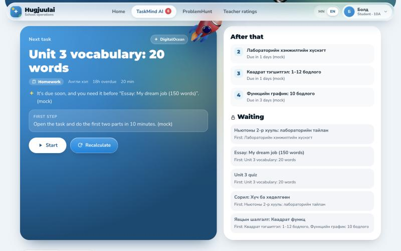
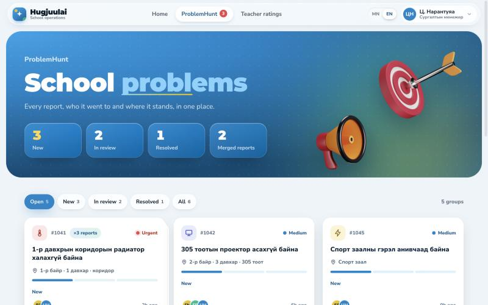
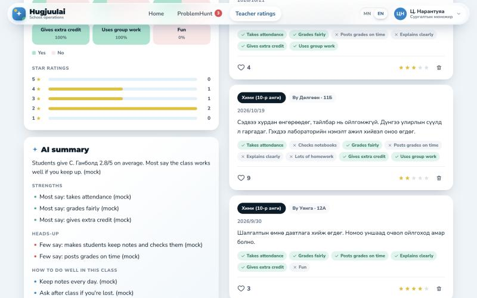

<div align="center">

# Hugjuulai · Сургалтын үйл ажиллагааны систем

**An AI school operations system for [erxes](https://erxes.io), powered by Gemma 4.**

Students get their next task picked for them, school problems reach the right people,
and teachers get honest feedback that stays polite.


Built at **Hacktoberfest Hack Day Ulaanbaatar × erxes Hub** · 24 Oct 2026 · by PixelPulse

</div>


## What it does

Hugjuulai has three modules, one for each part of a school day:

| Module | Who | What happens |
| --- | --- | --- |
| **TaskMind AI** | Teachers give exams and homework; students work through them | A student presses **Begin** and Gemma 4 picks the next task from deadlines, importance and dependencies, says why, and suggests a 5–10 minute first step. Each task gets small steps, tips and a hint chat that coaches instead of handing over answers. Teachers see class progress and who needs help. |
| **ProblemHunt** | Students report; teachers, staff and the administration act | A student reports a cold radiator or a broken projector, optionally with a photo. Gemma 4 sets the category and priority, routes the report to the right staff member or room teacher plus the administration, and merges duplicates into one group. Reports never turn into tasks or projects. |
| **Багшийн үнэлгээ** (TeacherRate) | Students rate teachers anonymously | Stars, yes/no questions (takes attendance, grades fairly, explains clearly…) and a comment. Gemma 4 checks the tone first and offers a polite rewrite of an insulting review, then summarizes each teacher's page. Teachers see only their own page; only the administration sees who wrote what. |

<table>
  <tr>
    <td></td>
    <td></td>
    <td></td>
  </tr>
  <tr>
    <td align="center"><b>TaskMind</b>: Begin picks the next task</td>
    <td align="center"><b>ProblemHunt</b>: reports grouped and routed</td>
    <td align="center"><b>TeacherRate</b>: AI summary and reviews</td>
  </tr>
</table>

<sub>The screenshots use the built-in mock model, so AI answers end in “(mock)”.</sub>

## How Gemma 4 is used

| Job | First choice | Model |
| --- | --- | --- |
| Prioritization: **Begin** and the AI-sorted Inbox | DigitalOcean serverless inference | `gemma-4-31B-it` |
| Everything else: small steps, learning help, ProblemHunt triage (with photo vision), tone checks, teacher summaries | Gemini API | `gemma-4-26b-a4b-it` |

Every job has a fallback chain. If the first provider fails, the other one is tried, then a
rule-based fallback, and the screen says which one answered. Every model answer is
validated: Begin can never pick a blocked task, unknown people are dropped from a report's
audience, and so on. See [demo/README.md](demo/README.md#how-gemma-4-is-used) for the full
breakdown.

## Repository layout

```
findedu/
├── demo/        the runnable app: one `pnpm start`, demo data, mock model
│   ├── api/     Node.js 22 + TypeScript, graphql-js; modules: taskmind, problemhunt, teacherrate
│   └── ui/      vanilla JS + GSAP, Mongolian and English
└── hugjuulai/   the erxes plugin scaffold (erxes 3.3.2): startPlugin API + React Module Federation remote
```

Both folders use the same layout: `erxes.json`, a pnpm workspace with `api/` and `ui/`, and
one folder per module under `api/src/modules/`. The features live in `demo/` for now; the
plugin is still the generated scaffold with a sample module. Moving a module over is mostly
copying files and swapping the JSON store for Mongoose models; the plan is in
[demo/docs/erxes-integration.md](demo/docs/erxes-integration.md).

## Quick start

Requires **Node.js 22.18+** and **pnpm** (`npm install -g pnpm`). TypeScript runs natively,
so there is no build step.

```sh
cd demo
pnpm install
cp .env.example .env   # paste your keys (see below)
pnpm start             # → http://localhost:3000
```

| Key in `.env` | Where to get it | Used for |
| --- | --- | --- |
| `AI_API_KEY` | [Google AI Studio](https://aistudio.google.com/apikey) (free) | everything except prioritization |
| `DO_API_KEY` | DigitalOcean → Serverless inference → Model access keys | Begin and the AI-sorted Inbox |

With one key, that provider does everything. With none, the app still runs on its rule-based
fallbacks. To rehearse with AI answers but no keys, start the mock model in a second terminal:

```sh
pnpm run mock
AI_API_KEY=mock AI_BASE_URL=http://localhost:11500/v1beta DO_API_KEY=mock DO_BASE_URL=http://localhost:11500/v1 pnpm start
```

## Try it

Switch users from the avatar menu (top right) to see each role:

| User | Role | Try |
| --- | --- | --- |
| Болд, Сараа, Тэмүүлэн | Student (10А) | TaskMind → **Begin** → **Start**; the Graph tab; report a problem; rate a teacher |
| Б. Оюунчимэг and five other teachers | Teacher | **Add exam / homework** with dependencies; class progress; reports for their rooms; their own ratings |
| Д. Энхтөр, Г. Мөнхзул, Б. Ганбаатар, О. Дорж | Staff | ProblemHunt reports routed to their specialty; mark them in review or resolved, reply |
| Ц. Нарантуяа | Administration | Every report, grouped; every teacher's ratings with the authors' names |

A three-minute demo script is in [demo/README.md](demo/README.md#demo-script-3-min).

## Run it inside erxes

The plugin joins a running erxes stack through its Redis:

```sh
cd hugjuulai
pnpm install
cp .env.example .env
pnpm run dev:api   # registers with the erxes gateway
pnpm run dev:ui    # serves http://localhost:3099/remoteEntry.js
```

Add `hugjuulai` to `ENABLED_PLUGINS` in the erxes `.env`, restart the gateway and core-api,
and open `http://localhost:3001/hugjuulai`. See [hugjuulai/README.md](hugjuulai/README.md)
for deployment and the trusted-gateway rules.

## Development

Run these in `demo/`:

| Command | What it does |
| --- | --- |
| `pnpm start` | API and UI on http://localhost:3000 |
| `pnpm run dev:api` | same, restarting on file changes |
| `pnpm test` | unit tests: Begin and ranking, guides, ProblemHunt, TeacherRate, Gemini and DigitalOcean request formats |
| `pnpm run check` | strict TypeScript |
| `pnpm run mock` | stand-in Gemma 4 on port 11500 |
| `pnpm run reset` | restore the demo data |

**Deploy:** `AI_API_KEY=… DO_API_KEY=… docker compose up -d --build` on any Docker host
(no GPU needed). The `Dockerfile` also runs on DigitalOcean App Platform on port 8080.

## Tech stack

- **API:** Node.js 22 with native TypeScript, graphql-js, erxes-style typeDefs and resolvers, a JSON-file store
- **UI:** vanilla JavaScript, GSAP motion, Montserrat and Nunito Sans, Mongolian and English
- **AI:** Gemma 4 on the Gemini API and on DigitalOcean Gradient AI serverless inference; any OpenAI-compatible server (Ollama, vLLM) also works
- **Plugin:** erxes-api-shared, Mongoose, React 18, Rspack Module Federation, Tailwind CSS 4, erxes-ui

## Documentation

- [demo/README.md](demo/README.md): every feature, the GraphQL API, troubleshooting, the demo script
- [demo/docs/erxes-integration.md](demo/docs/erxes-integration.md): moving the demo into the plugin (collections, permissions)
- [demo/AGENTS.md](demo/AGENTS.md): code layout and rules for contributors and coding agents
- [hugjuulai/README.md](hugjuulai/README.md) and [hugjuulai/docs/erxes-integration.md](hugjuulai/docs/erxes-integration.md): how the plugin plugs into erxes

## Монголоор

**Hugjuulai** бол erxes дээрх сургалтын үйл ажиллагааны систем, Gemma 4 ашигладаг:

- **TaskMind AI**: зөвхөн багш шалгалт, гэрийн даалгавар оруулна. Сурагч өөрт хамаарах ажлуудаа Inbox болон графаар харна. `Begin` хугацаа, ач холбогдол, хамаарлыг тооцож дараагийн ажлыг санал болгоно.
- **ProblemHunt**: сурагч сургуулийн асуудлыг мэдээлнэ. AI ангилж, ижил мэдээллийг бүлэглэнэ. Мэдээллийг холбогдох багш, ажилтан, захиргаа харна.
- **Багшийн үнэлгээ**: сурагч багшаа нэрээ нууцлан үнэлнэ. Илгээхээс өмнө Gemma 4 доромжилсон үгийг шалгаж, эелдэг хувилбар санал болгоно.

Эхлүүлэх: `cd demo && pnpm install && pnpm start`. Дэлгэрэнгүйг [demo/README.md](demo/README.md)-ээс үзнэ үү.

## License

[MIT](LICENSE) © 2026 PixelPulse. 3D icons: CC0 ([3dicons.co](https://3dicons.co)). GSAP: free under its standard license. Fonts: SIL OFL.
